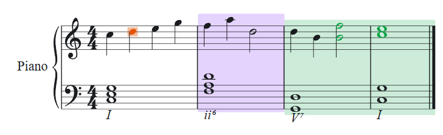

# Sheet Skills

Two independent Codex skills that render interactive sheet music directly in the Codex Desktop conversation by default. Both use WebAssembly for engraving and support standalone HTML export on request.



## Choose a skill

| Skill | Engraving engine | Input formats | Annotation targets |
| --- | --- | --- | --- |
| [sheet-display-skill](skills/sheet-display-skill/) | Verovio 6.4.1 | MEI, MusicXML, MXL, ABC | Measures, ranges, noteheads, stems, beams, and rendered elements with an ID |
| [webmscore-display-skill](skills/webmscore-display-skill/) | webmscore 1.2.1 with MuseScore 4.0.0 | MSCZ, MSCX, MusicXML, MXL, MIDI | Measures, ranges, and noteheads located by staff and position |

webmscore transcribes MIDI into notation. To engrave MIDI with Verovio, first transcribe it to MusicXML. For a comparison, select the same measures in each skill because page breaks vary by engine.

## Install in Codex

In Codex, select the built-in `$skill-installer` skill and use one of the prompts below.

```text
$skill-installer help me install skills/sheet-display-skill from https://github.com/lupnis/sheet-skills using the master branch
```

```text
$skill-installer help me install skills/webmscore-display-skill from https://github.com/lupnis/sheet-skills using the master branch
```

From a local checkout, you can copy either complete directory under `skills/` into `.agents/skills/` for a project or `~/.agents/skills/` for your user account. [Codex skill discovery](https://learn.chatgpt.com/docs/build-skills#where-codex-loads-local-skills)

## Use in Codex

Provide a score path, choose a skill, and describe the passage you want to see. The skill displays the score inline, with pagination and selectable analysis when applicable.

> Use $sheet-display-skill to display measures 5–8 from this MusicXML file. Highlight the cadence and show its analysis when I select measure 8.

> Use $webmscore-display-skill to show the first two complete pages of this MIDI file. Keep all the systems on each page together.

Both skills can show complete pages or short excerpts, with optional annotations in either view. Ask for a page range when page layout matters and a measure range when discussing a specific passage. With webmscore, you can also ask to read one system at a time.

- [Verovio rendering and annotation reference](skills/sheet-display-skill/references/usage.md)
- [webmscore rendering and annotation reference](skills/webmscore-display-skill/references/usage.md)

## Run the shared example in a browser

Use Node.js 20 or later. Run these commands from the repository root. On Windows, use `npm.cmd` if PowerShell blocks `npm.ps1`.

```sh
npm --prefix skills/sheet-display-skill ci --ignore-scripts
node skills/sheet-display-skill/scripts/render.mjs examples/demo.musicxml --annotations examples/demo-marks.json --max-width 500 --out out/verovio.html --standalone

npm --prefix skills/webmscore-display-skill ci --ignore-scripts
node skills/webmscore-display-skill/scripts/render.mjs examples/demo.musicxml --annotations examples/demo-marks.json --max-width 500 --out out/webmscore.html --standalone
```

Open either output in a browser and select a measure to see the analysis.

## Contributing and license

See the [contribution guide](CONTRIBUTING.md) for verification and release steps. Repository code and original examples are licensed under [GPL-3.0-only](LICENSE). See [third-party notices](THIRD_PARTY_NOTICES.md) for the engines, font, and libraries.
